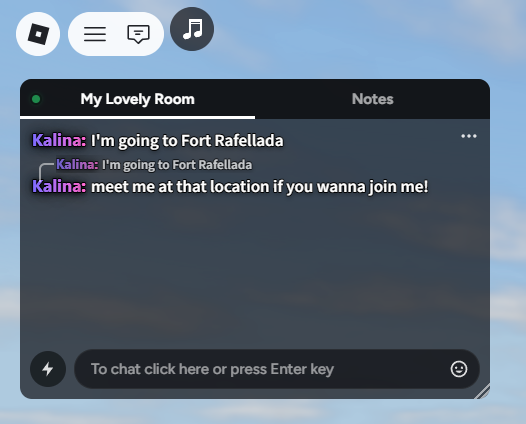
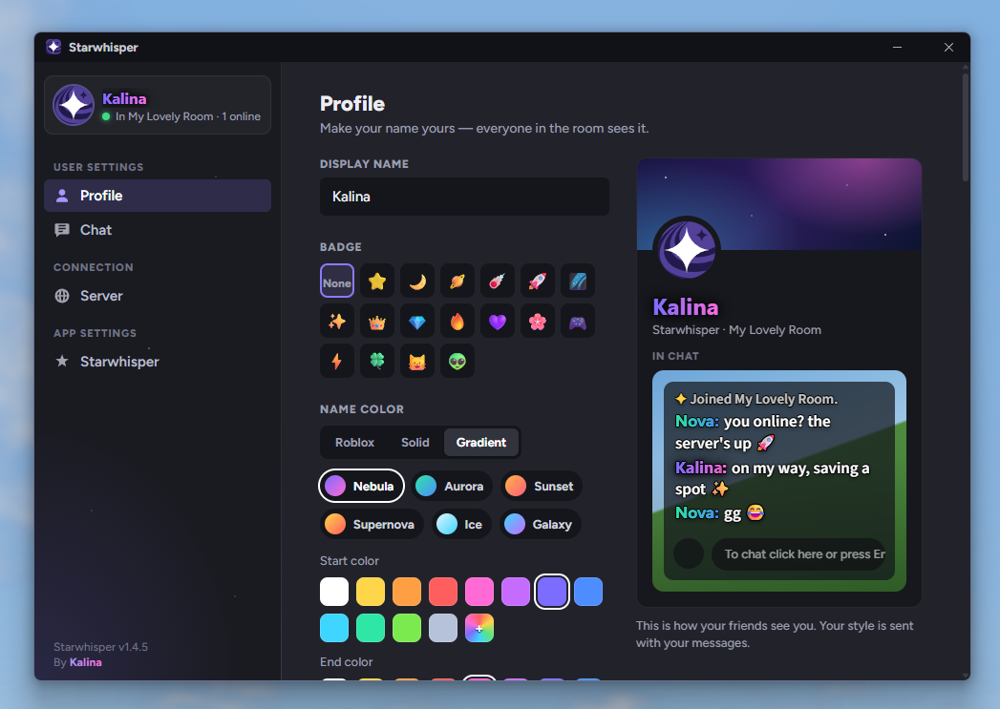
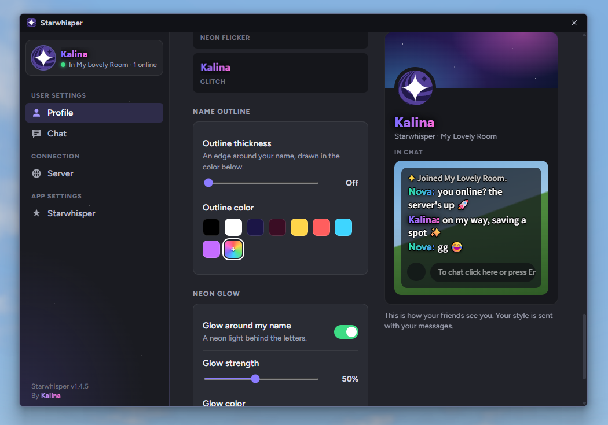
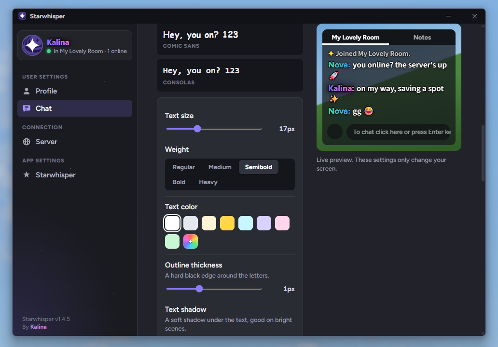
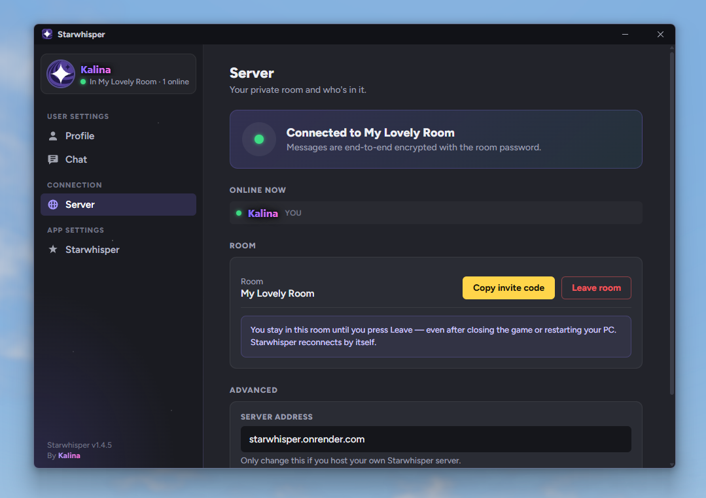
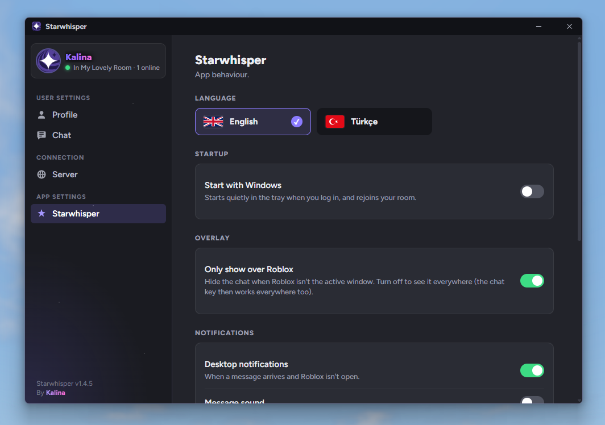

# Starwhisper

A private, end-to-end encrypted chat overlay for Roblox.

Starwhisper sits on top of the Roblox window and looks like Roblox's own chat, but it runs completely outside the game. Nothing is injected into Roblox.

## Download

Get the latest **Starwhisper-Setup-x.y.z.exe** from [Releases](https://github.com/Basementt/starwhisper-releases/releases/latest) and run it. Installed apps update themselves with one click.

The installer is not code-signed, so Windows SmartScreen may show a warning. Choose **More info → Run anyway**.

## Features

- Roblox-style chat that follows the Roblox window and fades when idle
- End-to-end encryption with the room password; the server only sees ciphertext
- Rooms you join once with an invite code, reconnecting automatically
- Shared Notes tab, replies, @mentions with a ping, clickable links
- Emoji picker with search and `:shortcode:` support
- Custom name color, gradient, font, animation, outline and neon glow
- Adjustable chat font, size, outline, shadow, colors, opacity and fading
- English and Turkish

## Screenshots

| Profile | Name effects |
|---|---|
|  |  |
| **Chat** | **Server** |
|  |  |
| **App settings** | |
|  | |

## Getting started

1. Open Starwhisper from the tray icon and set your display name under **Profile**.
2. Under **Server**, create a room with a name and a password, or paste an invite code.
3. Use **Copy invite code** to share the room with friends.
4. Start Roblox and press the chat key (default `/`) to type.

By Kalina.
